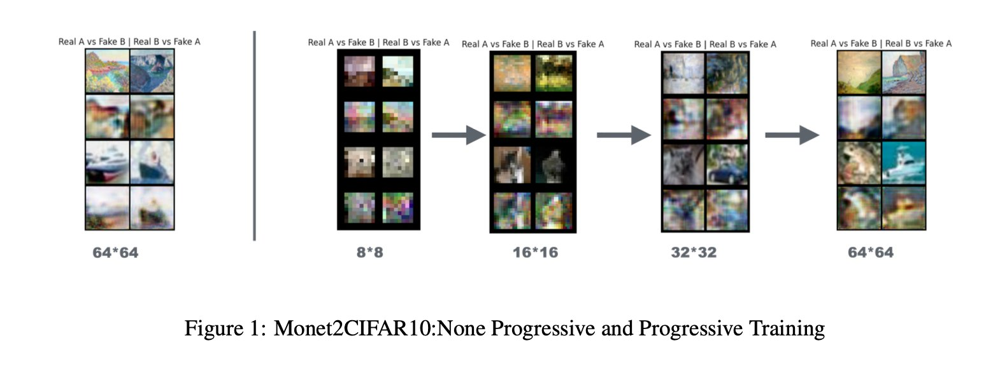
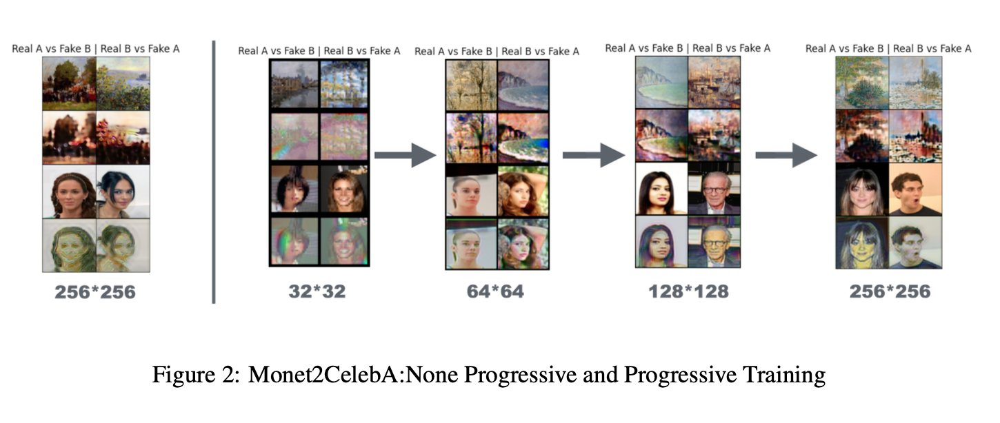
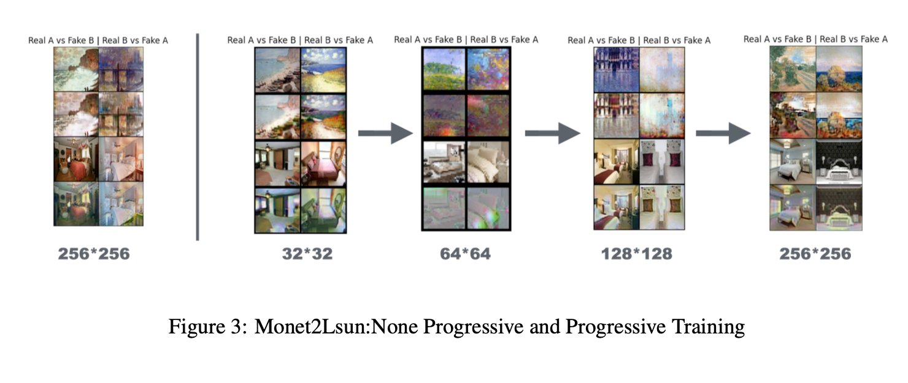
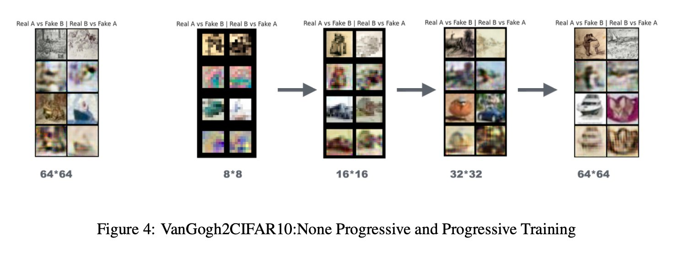
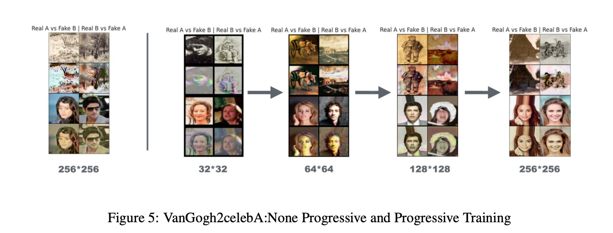
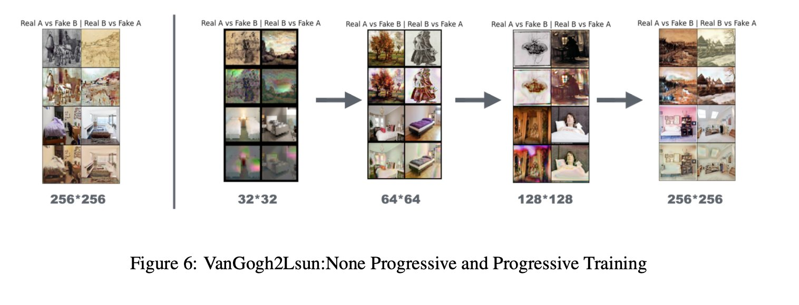

# Progressive Growing CycleGAN for High-Resolution Image Translation

> Combining CycleGAN and Progressive Growing GAN to achieve high-resolution unpaired image-to-image style transfer.

---

## Overview

This project explores whether progressive training can improve CycleGAN-based style transfer without paired data or additional control signals. We designed and evaluated three model variants across 6 dataset pairs.

**Key finding:** Non-progressive full-size training outperforms progressive training for style transfer tasks — progressive growing, while effective for resolution upscaling, introduces unnecessary information bottlenecks when input/output resolution is the same.

---

## Models

| Model | Description |
|-------|-------------|
| **Non-Progressive (Full-Size)** | Standard CycleGAN-style encoder-decoder, trained at full resolution |
| **Progressive (Upsampling only)** | Progressive training applied only to upsampling layers |
| **Two-End Progressive** | Progressive training on both downsampling and upsampling layers |

---

## Architecture

All models follow an **encoder-decoder** format with residual connections:

```
Input (3×H×W)
    → Input Layer (64×H×W)
    → 3× Downsampling Blocks (→ 512×H/8×W/8)
    → 9× Residual Blocks (512×H/8×W/8)
    → 3× Upsampling Blocks (→ 64×H×W)
    → Output Layer (3×H×W)
```

**Key design choices:**
- `InstanceNorm` instead of BatchNorm — preserves per-image feature distribution
- `WSConv2d` (weight-scaled convolution) in output/upsampling layers — stabilizes learning rate across depths
- `PixelNorm` after upsampling — prevents feature magnitude explosion
- Alpha blending during progressive transitions — smoothly introduces new layers

**Training objective** follows the original CycleGAN formulation:

```
L(G, F, D_X, D_Y) = L_GAN(G, D_Y, X, Y) + L_GAN(F, D_X, Y, X) + λL_cyc(G, F) + γL_id(G, F)
```

---

## Datasets

**Style domains:**
- Monet2Photo (1,193 Monet paintings)
- Van Gogh Drawings (1,000 images)

**Real image domains:**
- CIFAR-10 (resized to 64×64)
- CelebA (resized to 256×256)
- LSun Bedroom (resized to 256×256)

250 images used for training, 50 for testing per dataset pair.

---

## Results

### Qualitative Results

**Monet Style Transfer**


*Figure 1: Monet→CIFAR10 — Non-Progressive (left) vs Progressive Training (right, 8×8 → 64×64)*


*Figure 2: Monet→CelebA — Non-Progressive (left) vs Progressive Training (right, 32×32 → 256×256)*


*Figure 3: Monet→LSun — Non-Progressive (left) vs Progressive Training (right, 32×32 → 256×256)*

**Van Gogh Style Transfer**


*Figure 4: VanGogh→CIFAR10 — Non-Progressive (left) vs Progressive Training (right, 8×8 → 64×64)*


*Figure 5: VanGogh→CelebA — Non-Progressive (left) vs Progressive Training (right, 32×32 → 256×256)*


*Figure 6: VanGogh→LSun — Non-Progressive (left) vs Progressive Training (right, 32×32 → 256×256)*

---

### Quantitative Results

#### FID Score (lower is better)

| Style | Dataset | Non-Progressive | Progressive |
|-------|---------|----------------|-------------|
| Monet | CIFAR10 | **152.03** | 175.25 |
| Monet | CelebA | 442.81 | **440.92** |
| Monet | LSun | **272.53** | 305.44 |
| Van Gogh | CIFAR10 | **198.12** | 204.66 |
| Van Gogh | CelebA | **409.37** | 418.93 |
| Van Gogh | LSun | 434.75 | **432.81** |

#### Inception Score (higher is better)

| Style | Dataset | Non-Progressive | Progressive |
|-------|---------|----------------|-------------|
| Monet | CIFAR10 | **1.71** | 1.70 |
| Monet | CelebA | 2.03 | **2.32** |
| Monet | LSun | **1.94** | 1.75 |
| Van Gogh | CIFAR10 | **1.63** | 1.59 |
| Van Gogh | CelebA | **1.83** | 1.60 |
| Van Gogh | LSun | **2.30** | 2.11 |

> **Note:** Overall scores are low due to small dataset size (250 training images). FID and Inception Score are sensitive to dataset size — small samples lead to inaccurate distribution estimates.

---

## Why Progressive Training Underperforms Here

Progressive growing was designed for **resolution upscaling** (e.g., 64×64 → 1024×1024). Style transfer keeps input/output resolution the same, which creates a fundamental mismatch:

1. **Unnecessary compression** — to support 4 progressive steps on a 256×256 input, we must downsample to 32×32, discarding fine-grained features
2. **Misaligned layer roles** — progressive training forces deep layers to represent low-resolution features, inverting the typical abstraction hierarchy
3. **Two-end progressive failure** — when both encoder and decoder are progressive, the model outputs collapsed (black/green) images due to severe information loss in early downsampling stages

---

## Training Details

| Setting | Value |
|---------|-------|
| GPU | NVIDIA T4 (Google Colab) |
| Non-Progressive epochs | 10 |
| Progressive epochs | 8 (steps 0–2), 10 (step 3) |
| Alpha smoothing | 4 epochs per new layer (0.25 → 0.5 → 0.75 → 1.0) |

---

## References

- [CycleGAN](https://arxiv.org/abs/1703.10593) — Zhu et al., 2017
- [Progressive Growing of GANs](https://arxiv.org/pdf/1710.10196) — Karras et al., 2017
- [StyleGAN](https://arxiv.org/abs/1812.04948) — Karras et al., 2019
- [Stable Diffusion](https://arxiv.org/abs/2112.10752) — Rombach et al., 2021
- [DALL·E](https://openai.com/dall-e) — Ramesh et al., 2021
- [CLIP](https://arxiv.org/abs/2103.00020) — Radford et al., 2021
